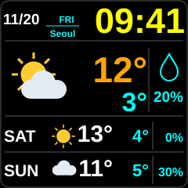
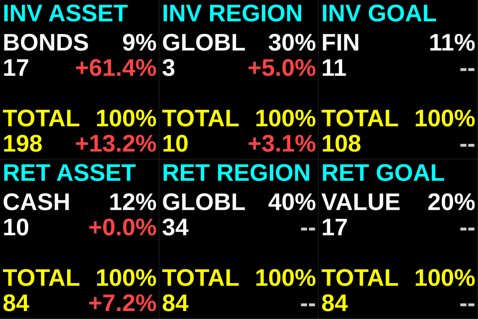
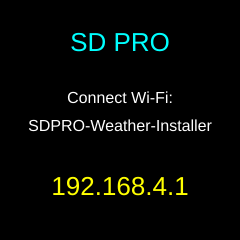

# customSmallTv

Four firmware builds for the 240 × 240 JUZIPi SD PRO (ESP8266).

| Weather | Ticker | Investment | Bootstrap |
| :---: | :---: | :---: | :---: |
|  |  |  |  |
| Local time, three-day weather and air quality. | Up to eight Yahoo Finance symbols with price, daily change and charts. | Portfolio and retirement goals from Google Sheets. | First-time installer with Wi-Fi and manual firmware upload. |

Display previews use sample data.

Run `make build` to generate `sdpro-weather.bin`, `sdpro-ticker.bin` and
`sdpro-investment.bin`, and `make bootstrap-build` to generate `sdpro-bootstrap.bin`.
All four files are written to `dist/`.

For first-time installation, upload a copy of `sdpro-bootstrap.bin` named
`SDP-Bootstrap.bin` in the factory updater. Connect to `SDPRO-Weather-Installer`
using the [installer Wi-Fi settings](firmware-bootstrap/src/main.cpp#L12),
open `http://192.168.4.1/` and upload your chosen firmware. Use the device's
Web OTA page for later updates.

## Credits

Based on [Home Assistant Mini-Display](https://github.com/piotrkochan/homeassistant-minidisplay).

Hardware research and inspiration:
[JUZIPi SD_PRO](https://github.com/JUZIPi-tech/SD_PRO),
[geekmagic-hacs](https://github.com/adrienbrault/geekmagic-hacs),
[geekmagic-tv-esp8266](https://github.com/bvweerd/geekmagic-tv-esp8266),
[smalltv-mod](https://github.com/giovi321/smalltv-mod).

## License

[MIT](LICENSE). See [third-party notices](THIRD_PARTY.md) for dependencies and assets.
