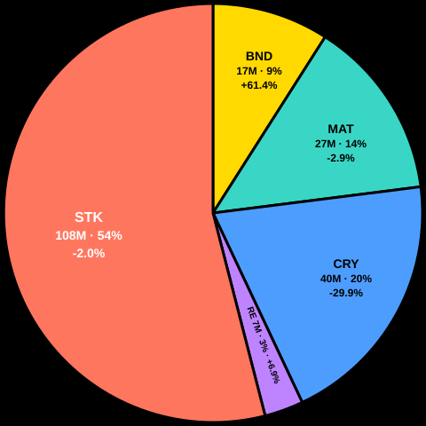
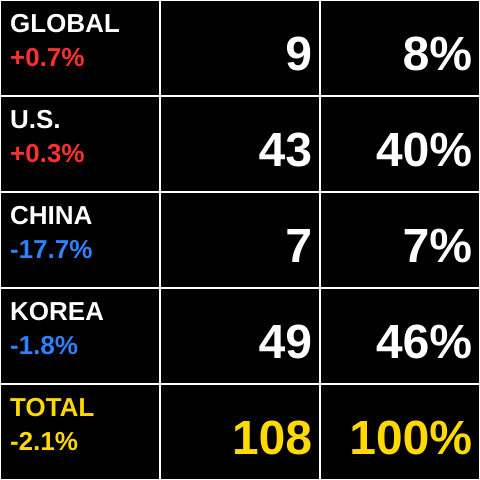
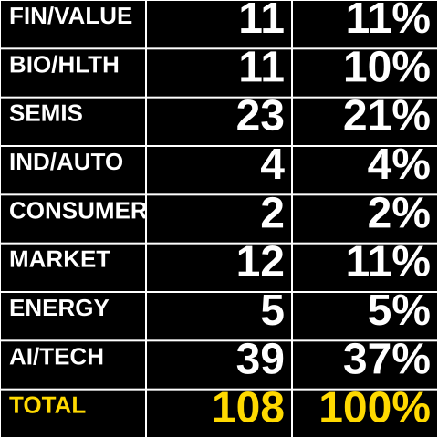
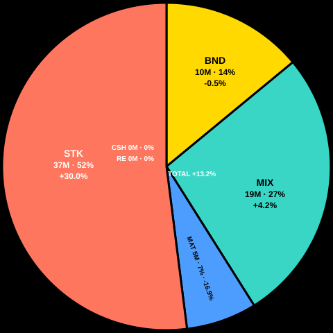
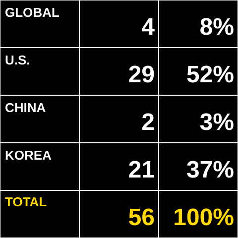
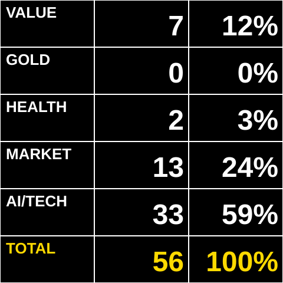

# SD PRO investment-summary firmware

The separate `sdpro-investment` profile rotates through six data-only pages:
three investment pages followed by three retirement-account pages. Asset pages
use a three-column grid for the label and P/L percentage, holding amount in
rounded whole millions of KRW, and share of the page total. Regional and
subcategory goal pages show holdings and their allocation rate. P/L percentages
are calculated against cost basis (`P/L / (holdings - P/L)`).

| Investment assets | Investment regions | Investment stock goals |
| :---: | :---: | :---: |
|  |  |  |
| **Retirement assets** | **Retirement regions** | **Retirement stock goals** |
|  |  |  |

## Build and install

From the repository root, run `make build-firmwares`. The image is exported as
`dist/sdpro-investment.bin`; a focused build is `pio run -e sdpro-investment`
from `firmware/`. The profile uses the same SD PRO ESP8266 board, display pins,
flash layout and network/OTA recovery path as the weather and ticker images.
No upload is performed by building the image.

Open the shared device portal at `/` to configure Wi-Fi and firmware updates.
The display fetches the investment goals and investment details worksheets,
plus the retirement goals worksheet, after Wi-Fi connects. It rotates pages
every 12 seconds, refreshes each worksheet every six hours, and retries failures
with a capped backoff of up to five minutes. A failed refresh keeps that page's last
successful values visible. `/api/v1/status` reports the individual fetch states
as `investment*`, `investmentRegions*`, and `investmentRetirement*` fields.
Requests are synchronous with a six-second timeout, so a slow connection can
briefly delay local web and OTA handling.

## Data source and limitations

The firmware requests the published **Investment Goals** worksheet
(`gid=827857148`), including its **Stock Detailed Investment Goals** section,
and the published **Investment Details** worksheet (`gid=379347683`) as CSV.
It discovers the required columns from their headers rather than relying on
fixed column numbers, tolerates reordered or additional columns, and aggregates
the listed stock positions by region. The parser is streamed with a 16 KiB
response limit; it does not buffer a complete worksheet. It rejects incomplete
or malformed values instead of replacing cached data.

Retirement pages use the published **Investment Goals** worksheet
(`gid=827857148`) from the retirement workbook. It provides the retirement asset
summary, stock-region totals and detailed stock-goal allocations. The three
retirement pages display asset P/L, regional stock allocation and detailed
stock-category allocation, respectively.

Both workbooks are publicly published. Anyone with access to their published
URLs may be able to read their contents; do not use this build with sheets that
should remain private. The ESP8266 HTTPS client follows the Google redirect
but, like the existing firmware's public-data clients, does not authenticate
the server certificate. The data is informational, not financial advice. The
firmware makes read-only requests and does not send holdings back to Google;
Google still receives ordinary connection metadata such as the network IP
address.

The image is dedicated to these investment and retirement summaries and does
not include weather pages or the Yahoo ticker editor.
